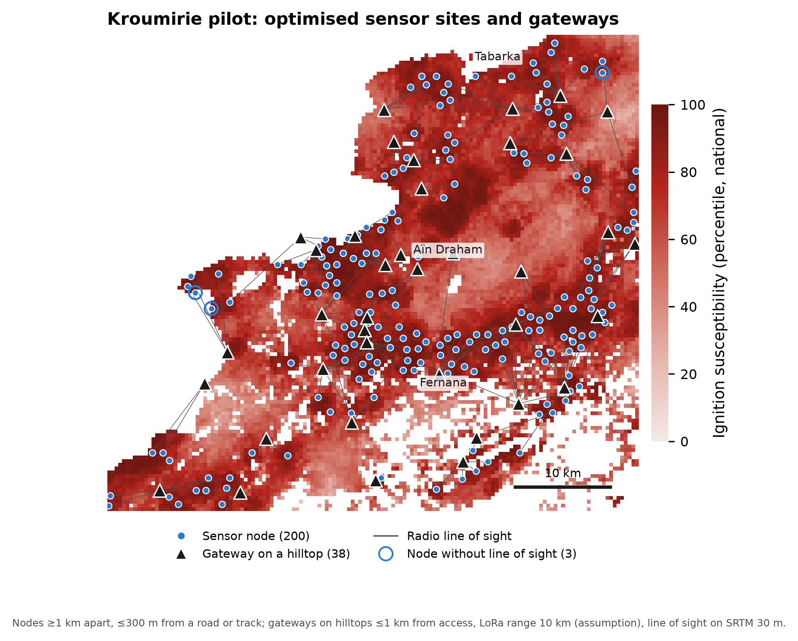
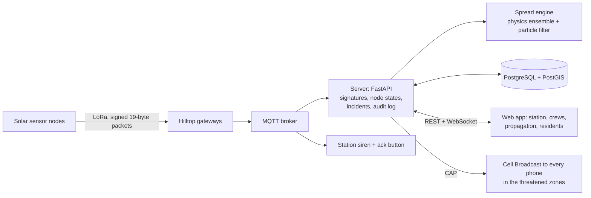
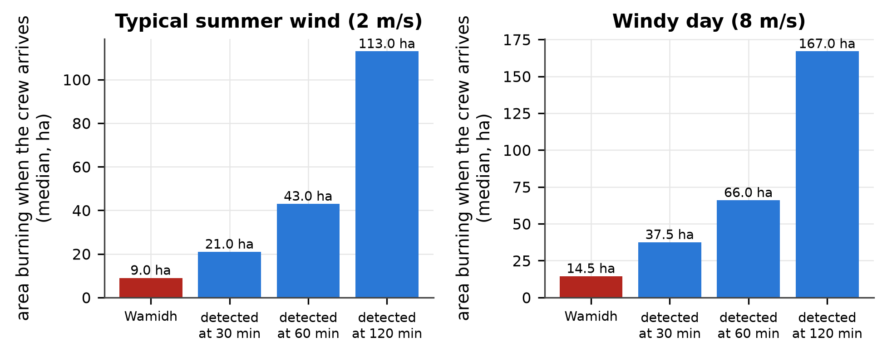
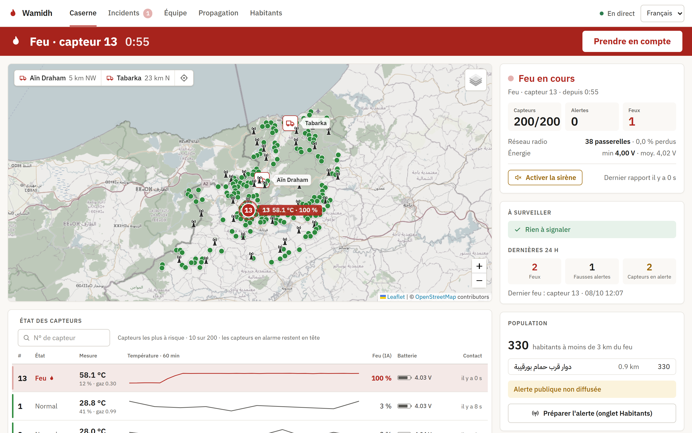
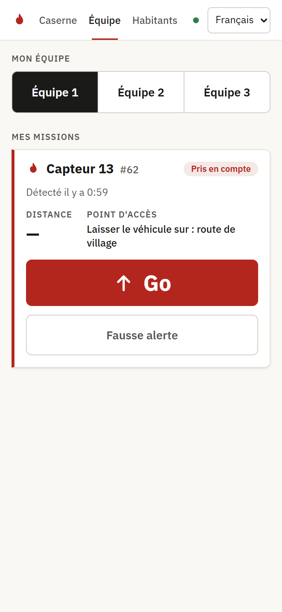
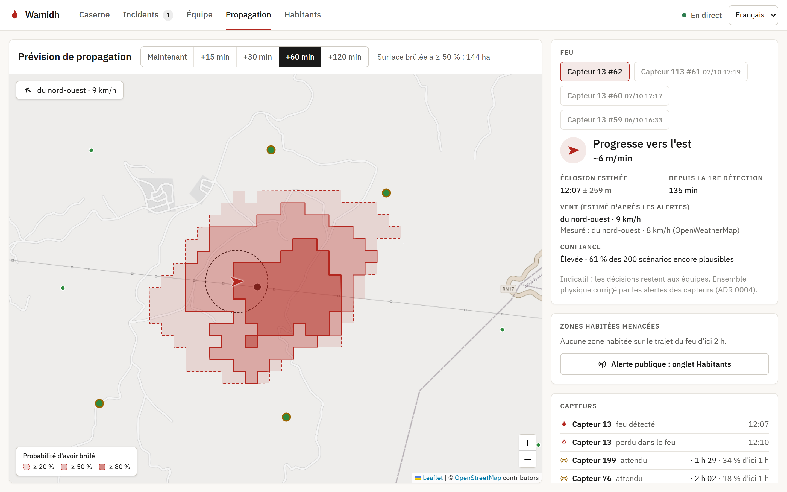

# Wamidh — catch forest fires in their first minutes

**Wamidh** is a low-cost network of solar-powered sensors for the forests of northern Tunisia. It
detects a fire within minutes and turns that detection into action:

1. the fire station's siren sounds;
2. the crew is guided turn by turn to the nearest forest track;
3. the system predicts where the fire is heading;
4. people in the villages it threatens get a warning in Arabic on their phones.

> **The problem in two numbers:** the area burned by forest fires in Tunisia rose from
> **2,400 ha in 2012 to 25,808 ha in 2021**, and **95%** of these fires are started by people.
> Fires start where people meet the forest, so it is possible to predict where they will start.

Entry for the IEEE TSYP14 NEXUS Technical Challenge (Environmental & Climate Sensing track).



---

## How it works

| Step | What happens | Where in the repo |
|---|---|---|
| **Place** | An AI model trained on 2,910 fires seen by satellite (NASA FIRMS, 2001–2025) maps where fires start across northern Tunisia. An optimiser then picks the sensor and gateway sites. | [`placement/`](placement/) |
| **Sense** | Each solar node reads gas, heat, infrared flame and images, and decides *normal / alert / fire* on board. It sends a signed 19-byte LoRa packet; no image ever leaves the node. | [`simulator/`](simulator/) (stands in for the hardware for now), [`contracts/`](contracts/) |
| **Alert** | The server checks each message's signature, opens an incident and sounds the station siren within seconds. | [`backend/`](backend/) |
| **Coordinate** | The station dashboard shows the live map and the incident timeline, with an *Acknowledge* button and an audit log of every action. | [`web/`](web/) |
| **Respond** | The crew presses **Go** and is guided to the nearest track that reaches the fire. The dispatcher confirms an Arabic Cell Broadcast alert to the threatened villages. | [`web/`](web/), [`zones/`](zones/) |
| **Anticipate** | A spread engine combines fire physics (terrain, fuel, wind) with the order in which sensors detect the fire. It forecasts where the fire will be in 15–120 min. | [`spread/`](spread/) |



There are no microservices. The spread engine is a library inside the server, and the whole stack
runs on one laptop, offline if needed.

## Impact

We measured impact with our own spread model on the real Kroumirie terrain. We started 60 fires
near sensors and asked one question: **how large is the fire when the first crew arrives?** With
Wamidh, the timing includes the sensor's own detection, 2 min to acknowledge, 3 min to leave the
station and the real road route from the Aïn Draham station. Without Wamidh, it is the same fire and
the same crew, but the fire is found 30, 60 or 120 min after it starts.

| Median area when the crew arrives | **Wamidh** | found at 30 min | at 60 min | at 120 min |
|---|---|---|---|---|
| Typical summer wind (1.9 m/s) | **9 ha** | 21 ha | 43 ha | 113 ha |
| Windy day (8 m/s) | **14.5 ha** | 37.5 ha | 66 ha | 167 ha |

Compared with a fire found after one hour, **the crew meets a fire four to five times smaller**.
These are modelled sizes at the start of the attack, not final burned areas. Fire size when crews
arrive decides whether the first attack succeeds.

- **Lives and homes:** a smaller fire when crews arrive, and a warning in Arabic on every phone in
  the threatened villages. It needs no registration, no app and no data plan, so basic phones get
  it too.
- **Firefighters:** crews get a position, a route and a forecast instead of a column of smoke.
- **Forests and livelihoods:** cork, grazing, honey and aromatic plants depend on these forests.
  Reported losses are 20,000–50,000 dinars per burned hectare. Meeting the median fire 34–52 ha
  smaller is worth on the order of 0.7–2.6 million dinars per fire, if the attack holds. This is
  an order of magnitude, not a forecast.
- **Community:** a local volunteer association looks after the nodes, explains alerts to residents
  who cannot read them and leads prevention work. The public risk map is shared with
  municipalities.
- **Sustainable Development Goals:** 3 (health), 8 (decent work), 11 (communities), 13 (climate
  action) and 15 (life on land).



## Key results

All numbers below are measured, not claimed. Assumed parameters are labelled `ASSUMPTION` in the code and config.

- **Placement model:** validated on later fires in governorates it never saw. ROC-AUC is 0.71
  under spatial cross-validation; a random split would give 0.81, an optimistic score because
  nearby cells leak into the test set. It places 200 sensors on the hotspots of the Kroumirie
  forest, all in the national top 10% of risk and near a track. 38 hilltop gateways are checked
  for radio line of sight.
- **Spread engine:** on 30 hidden test fires, its error on the fire's heading falls from 15° to
  **4° after three sensor detections**.
- **Software:** the whole chain is built and tested on 200 simulated sensors, which use exactly
  the message contract the hardware will use. The hardware node is designed but not built yet.

Report-ready figures and `metrics.json` are in [`docs/figures/`](docs/figures/). Design decisions
are explained in [`docs/adr/`](docs/adr/).

| Station dashboard | Crew app | Spread forecast |
|---|---|---|
|  |  |  |

---

## Run it

### Requirements (Windows)

- [Docker Desktop](https://www.docker.com/products/docker-desktop/) runs the database and the MQTT
  broker.
- Python 3.11 or newer.
- Node.js 20.19 or newer (or 22.12 or newer).

### One-time setup

From the repository root, in PowerShell:

```powershell
python -m venv .venv
.venv\Scripts\python -m pip install -e contracts/python -e spread -e placement -e zones -e simulator -e backend
cd web; npm install; cd ..
copy .env.example .env      # then set POSTGRES_PASSWORD (development only)
```

### Start everything

Double-click **`start.bat`**, or run it from a terminal:

```powershell
start.bat          # opens the station dashboard in your default browser
start.bat kiosk    # opens it as a full-screen station screen that can sound the siren (Edge)
```

`start.bat` does all of the following:

1. starts Docker Desktop if it isn't running;
2. starts the database and the MQTT broker, and applies the database schema;
3. installs the 200 virtual sensors at the optimised sites;
4. opens the backend, the sensors and the web app, each in its own window;
5. opens the dashboard.

If Wamidh is already running, it only opens the dashboard.

| Page | Address |
|---|---|
| Station dashboard | <http://127.0.0.1:5173/station> |
| Crew app | <http://127.0.0.1:5173/crew> |
| Residents (public page) | <http://127.0.0.1:5173/residents> |
| API docs (OpenAPI) | <http://127.0.0.1:8000/docs> |

To stop, close the Wamidh windows, then run `docker compose stop`.

### Simulate a fire

While the stack is running, open a second terminal at the repository root:

```powershell
.venv\Scripts\python -m wamidh_sim.ignite --list          # every sensor and its state
.venv\Scripts\python -m wamidh_sim.ignite 3               # a fire starts next to sensor 3
.venv\Scripts\python -m wamidh_sim.ignite 3 --ramp 10     # ... with smoke building up in 10 s
.venv\Scripts\python -m wamidh_sim.ignite 3 --out         # the fire is put out
.venv\Scripts\python -m wamidh_sim.ignite 5 --power off   # sensor 5 loses power (maintenance ticket)
.venv\Scripts\python -m wamidh_sim.ignite 5 --power on    # ... and comes back
```

What to watch after `ignite 3`:

1. Sensor 3 turns orange (*alert*), then red (*fire*).
2. The alarm band and the siren go off on the station dashboard.
3. Press *Acknowledge*, then open the crew app and press **Go**.
4. Ignite a neighbouring sensor and watch the spread forecast sharpen.

When the crew marks the incident *under control* or *closed*, the simulated world puts the fire
out. The sensors then report normal on their own, because the backend never overrides what a
sensor reports.

### Optional data

- **In-app turn-by-turn navigation** needs the OpenStreetMap roads of Tunisia. Download them with
  `python -m placement.steps.01_download --config config/pilot_kroumirie.yaml --only osm` (run
  it from `placement/`).
- **Wind for the spread forecast:** put a free OpenWeatherMap key in `.env`. Without it, the
  forecast uses the default wind in `backend/config/dev.yaml`.
- **Resident alert zones:** put a free OpenCelliD key in `.env`, then run
  `.venv\Scripts\python -m zones.pipeline --download` (see [`zones/README.md`](zones/README.md)).
  The next `start.bat` loads the zones automatically.
- **Rebuilding the placement model from raw data:** see [`data/README.md`](data/README.md), then
  run `python -m placement.pipeline --config config/pilot_kroumirie.yaml` from `placement/`.

### Tests

```powershell
cd backend; ..\.venv\Scripts\python -m pytest; cd ..   # same for contracts/python, spread, placement, zones, simulator
cd web; npm test; cd ..
```

## Repository layout

```
contracts/   message contract shared by sensors, simulator and server (MQTT topics, packet, schemas)
placement/   AI risk model and sensor/gateway placement (figures and metrics for the report)
spread/      fire spread prediction engine (physics ensemble + particle filter)
backend/     FastAPI server: ingest, node states, incidents, audit log, routing, alerts
web/         React web app (PWA): station dashboard, crew app, propagation, residents; Arabic/French/English
zones/       population alert zones for Cell Broadcast
simulator/   virtual sensor nodes publishing the same signed messages as the real hardware will
docs/        architecture decisions (adr/) and report figures (figures/)
```

## Responsible by design

- **No fake alarms:** every message is signed with its node's key, and unsigned or replayed
  messages are rejected.
- **People decide:** a public alert needs a dispatcher's confirmation, and the spread forecast and
  suggested firebreaks are labelled *advisory*.
- **Privacy:** Cell Broadcast stores no phone numbers, and the public page shows no sensor
  locations or live data.
- **Accountability:** every action on an incident is written to its audit log.
- **No stigma:** the risk map shows where fires tend to start, not who starts them.
